# User Guide

Engelsystem Client is an unofficial companion app for
[Engelsystem](https://github.com/engelsystem/engelsystem/), the volunteer-management system used by events like the
Chaos Communication Congress. It connects directly to your instance's Engelsystem server with your own API key; there is no
account with the app's developer and no tracking (see the [Privacy Policy](privacy.md)). Questions? See the
[FAQ](faq.md) or [Support](support.md).

> **Beta:** the app is currently tested through Apple's TestFlight. [Join the beta](https://testflight.apple.com/join/Ksn65tz9) on your iPhone or iPad
> (you need Apple's free TestFlight app). Please report problems through TestFlight's "Send Beta Feedback" or on
> [Support](support.md).

## What the app does (and does not)

- Shows **your own shifts**, the **news**, your **profile** (angel types, work logs), the instance's **locations**, and — on
  servers that support it — your **private messages**.
- Reminds you **before a shift starts** with local notifications.
- Works with **several instances at once**, and has an **Apple Watch** app that shows your next shift.
- It is **read-only for shifts**: you cannot sign up for or change shifts in the app. That needs support in the Engelsystem
  server first.

## iPhone, iPad and Mac

The app runs on **iPhone** and **iPad** (with a sidebar layout). On a **Mac with Apple silicon** the iPhone/iPad app can run as
well: the beta can be installed with the TestFlight app on the Mac, and the App Store offers the app for these Macs too. This
is **not tested in depth yet**, so some things may look or behave differently from the iPad app; please report problems on
[Support](support.md). The Apple Watch functions are not part of the Mac app.

## Try it without an account: Demo Mode

On the first screen tap **Try Demo Mode** (it is the first block of the form). The app fills itself with sample data (shifts, news, a few messages) and makes no
network requests. You can leave Demo Mode on, or switch it off and add a real server later in **Settings**.

## Connect your Engelsystem server

1. In a browser, sign in on your instance's Engelsystem website and open `/settings/api` (for example
   `https://engel.example.org/settings/api`). Press **Show API key** and copy the key. The app currently uses Engelsystem's
   REST API **v0-beta**.
2. In the app, on the first screen (or **Settings → Add Instance**), enter a **Name** (anything you like), the **Server**
   address (for example `https://engel.example.org`) and your **API key**.
3. Tap **Test Connection**. When it says the connection is verified, tap **Save**.

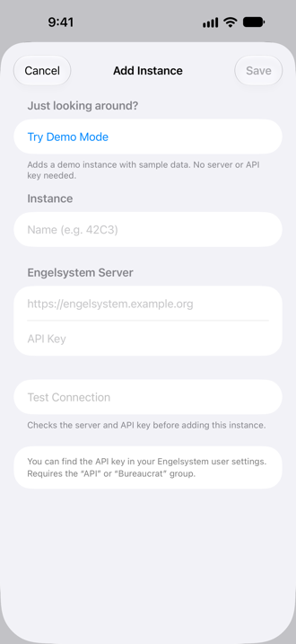{: width="200"}

A server address that starts with `demo://` (for example `demo://engelsystem.local`) is a demo instance: it needs no API key, the key field is greyed out.

The API key is stored in the iOS Keychain (synced through iCloud Keychain if you use it) and is only ever sent to the server
you entered.

## The main screen

The main screen is a list of areas in three groups: **Communication** (News, Messages), **Event** (Shifts, Locations) and
**Account** (Profile). Messages and Locations only appear if your server offers them. When the app starts, or an area is no
longer available, you always land on this list. Pull down to refresh everything at once; the banner at the top shows what is
syncing — with several active instances one line per instance, each with its steps ("2/5"). If an instance does not answer, its line turns orange; **Stop sync**
ends the sync (after a confirmation) and **Skip** leaves out just that instance. The line at the bottom of the list shows how old each instance's data is
(tap it to refresh). The gear button opens **Settings**.

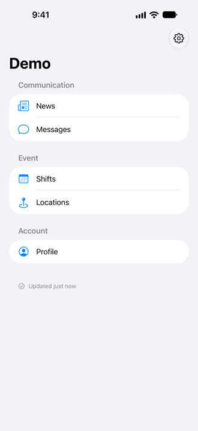{: width="200"}
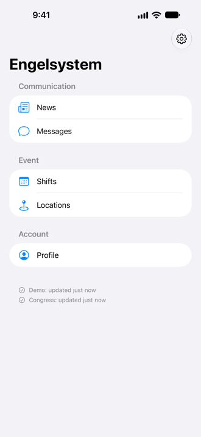{: width="200"}

### Shifts

{: width="240"}

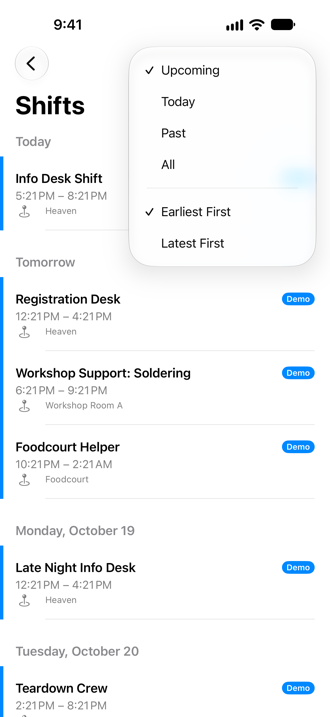{: width="200"}
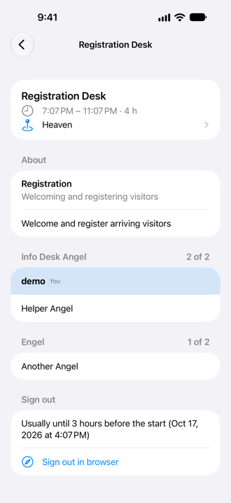{: width="200"}
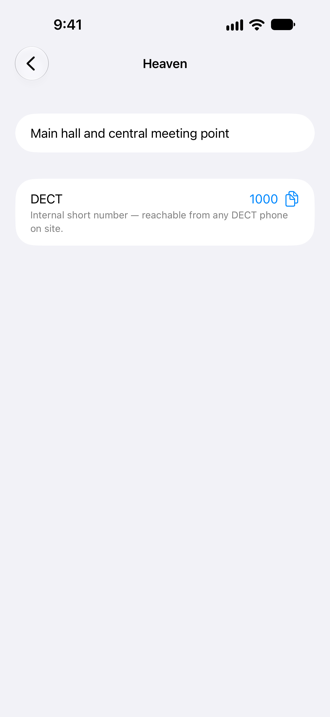{: width="200"}

Your shifts, grouped by day ("Today", "Tomorrow", …). Each shift shows its time and location; tap the location to read its
description. Pull down to refresh. A small badge shows which instance a shift belongs to when you use several.

The menu at the top right chooses which shifts are listed — **Upcoming** (running and not yet started, the default), **Today**, **Past** or **All** — and the order
(**Earliest First** or **Latest First**). The app remembers your choice on this device; the symbol is filled when it differs from the default.

Tap a shift to open its **details**: the shift type with its description, the shift's own description, the team by angel
type ("2 of 3" people, your own entry highlighted, entries marked as “did not show up”), tags, a night-shift hint, a link to
the talk page and — on your own shifts — until when you can sign out. **Sign out in browser** opens the shift on the
Engelsystem website; the app itself never signs you out. What is shown depends on the server: a page only shows what the
server tells (see the table below and the **Features** list of the instance). Pull down on the page to refresh just this
shift.

### News

{: width="240"}

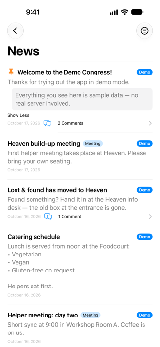{: width="200"}
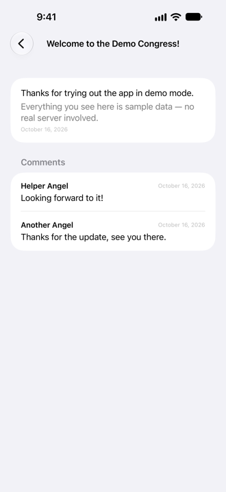{: width="200"}

Announcements from the instance. Pinned posts come first. Tap **Read More** to expand long posts and the **comments** link to
read the discussion.

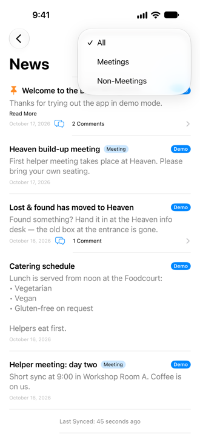{: width="200"}

The **filter button** at the top right (three lines in a circle; the circle is filled while a filter is on) opens a menu with
**All**, **Meetings** and **Non-Meetings**: show only the announcements that are meetings, only the others, or everything. The
filter is not remembered — after the next start of the app the list shows **All** again. With several instances the filter applies to
all of them.

### Profile

{: width="240"}

Your name with your **DECT and mobile numbers** (tap to call, copy with the copy button), your **angel types** (with a note
if you are a supporter or still unconfirmed) and your **work logs** with the total hours. The work logs are the entries
added by hand; hours from your shifts are not part of that list.

### Locations

{: width="240"}

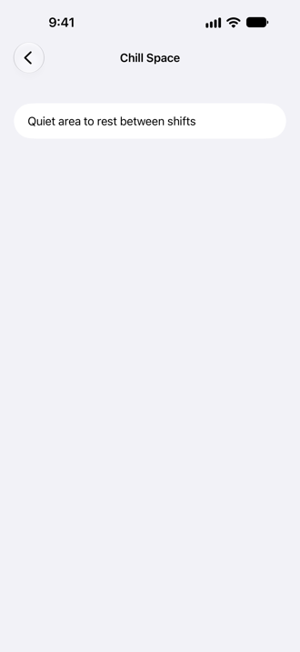{: width="200"}
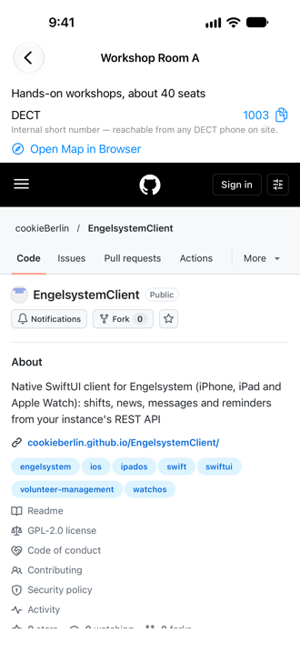{: width="200"}

All rooms and places of the instance with their descriptions. Tap one for details such as a DECT number and a link to the map. The map page is shown right inside the location screen (almost full screen, loaded fresh each time) with an **Open Map in Browser**
button. The map page's cookies (for example your consent) stay on your device; the app deletes them every 30 days by default (or keeps them only until you quit the app, if you choose that); in **Settings › Privacy** you can change that, delete them yourself or
switch to a plain link.

### Messages

{: width="240"}

{: width="200"}
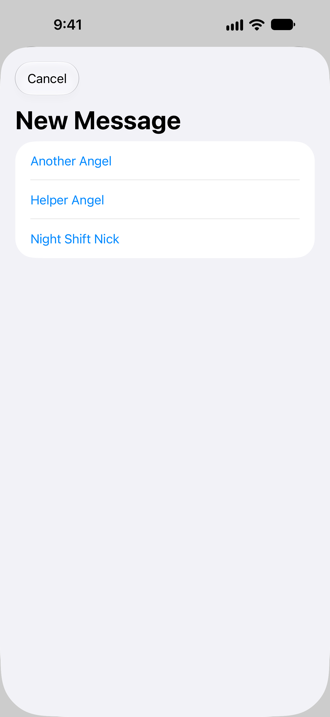{: width="200"}

Private messages with other helpers. Tap the compose button to start a conversation, tap a conversation to read and reply.
The **Messages** area only appears if at least one of your active servers supports it; if you do not see it, your server is
simply not offering it yet (it needs the open Engelsystem change
[#1720](https://github.com/engelsystem/engelsystem/pull/1720); see [Server compatibility](#server-compatibility)). You can delete your own messages; opening a conversation marks incoming messages as read.

## Settings

{: width="240"}

Settings is a short list of pages; each row shows a summary of its current state. The gear button on the main screen opens it.

### Instances

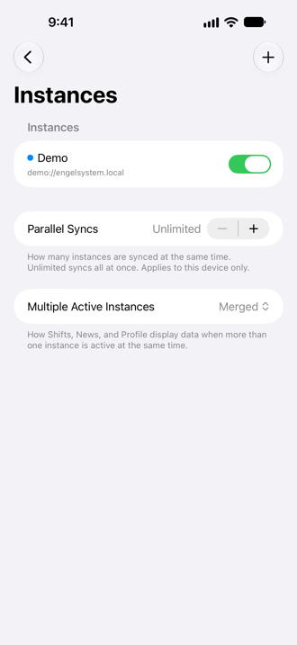{: width="200"}
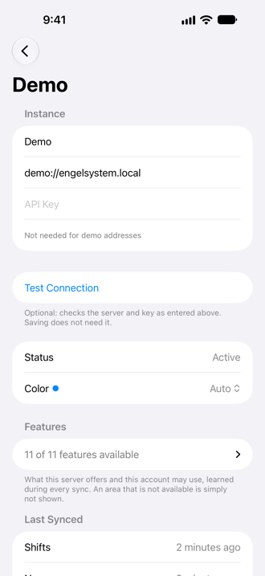{: width="200"}
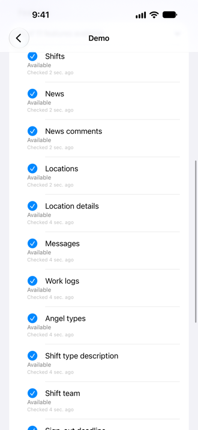{: width="200"}

All your instances. Use the switch to turn an instance on or off (switching one on refreshes its data right away); tap one to open
its page. There you change its **name**, **server** or **API key** right on the page — **Save** and **Discard** (which asks first)
appear as soon as something changed, and saving does not need a successful connection test (**Test Connection** is optional).
The page also shows the connection status, the **Features** list (see [below](#what-your-instance-offers-the-features-list)),
the times of the last syncs and the **color** of the instance. **Remove Instance** deletes it together with the data cached for it.

**Parallel Syncs** sets how many instances are refreshed at the same time (Unlimited by default, "1 at a time" syncs one after the
other); the setting belongs to this device, and the Watch has its own.

#### Several instances: display mode, colors and instance tags

**Multiple Active Instances** chooses how Shifts, News, Locations, Messages and Profile show more than one active instance:

- **Merged**: one list; every entry carries an **instance tag**.
- **Switcher**: one instance at a time, chosen with a control at the top.
- **Sectioned**: one section per instance, each under a **colored band** with the instance's name that you can tap to fold the section away.

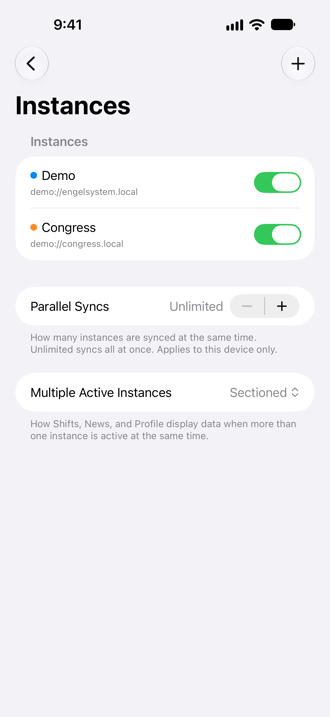{: width="200"}
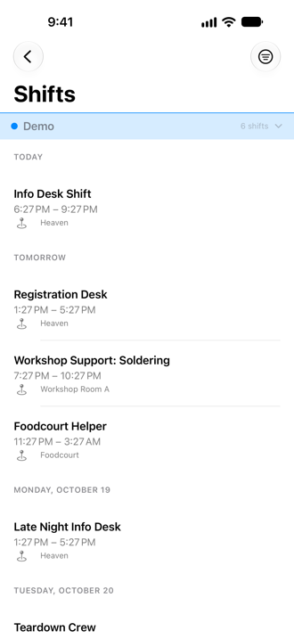{: width="200"}
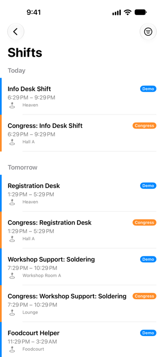{: width="200"}

Every instance has its own **color**. It is the color of the section band and of the **instance tag**: the small rounded label
with the instance's name that sits at the entries of a merged list (a shift, a news post, a location, a conversation) so you can see
at a glance which instance an entry belongs to. The same color shows as a dot at the instance in Settings. Pick it on the
instance's page under **Color** (the menu lists the colors with a swatch); **Auto** spreads the colors evenly over your instances,
and a color you picked is kept on all your devices.

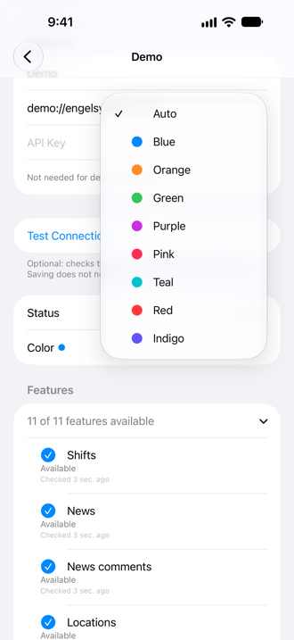{: width="200"}
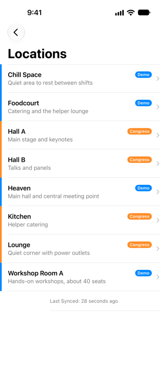{: width="200"}
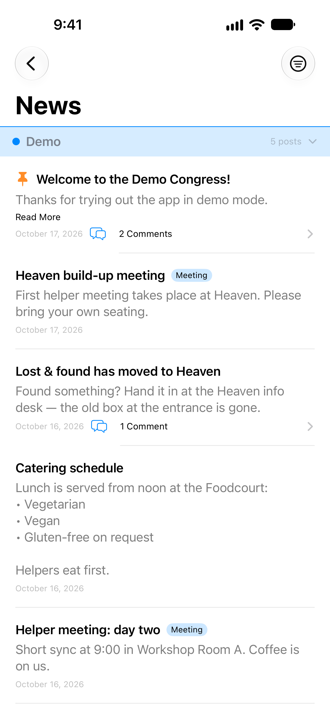{: width="200"}

### Notifications

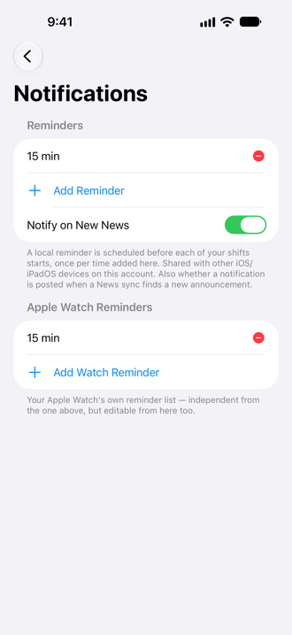{: width="200"}

The reminder times before each shift ("15 min", …). **Add Reminder** adds more, the red button removes one. **Notify on New News**
posts a notification when a background sync finds new announcements. **Apple Watch Reminders** is the same for your Watch,
independently of the iPhone list.

### Sync

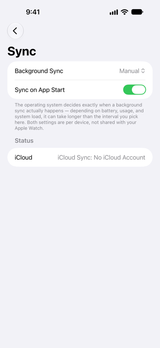{: width="200"}

**Background Sync** sets how often the app may refresh in the background (iOS decides the exact moment, so it can take longer than
the interval); **Sync on App Start** refreshes when you open the app. The page also shows the iCloud status and the last
background sync.

### Phone Numbers

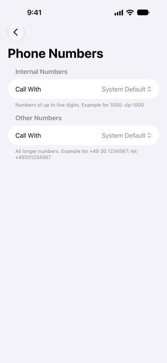{: width="200"}

Which app opens internal and other numbers (see "Phone numbers" above).

### Privacy

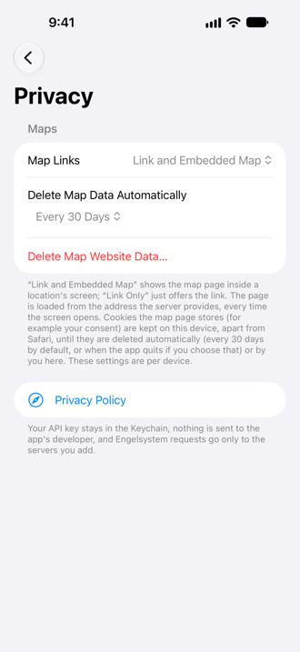{: width="200"}

**Map Links** (a plain link or the map inside the location screen), automatic deletion of the map page's data and **Delete Map
Website Data**, plus a link to the privacy policy.

### Diagnostics

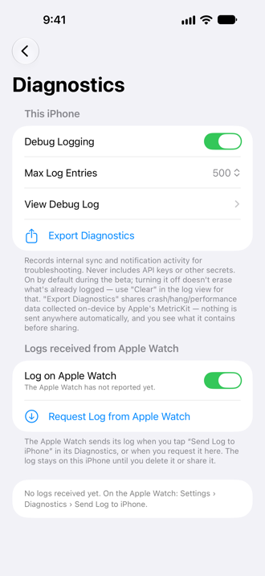{: width="200"}
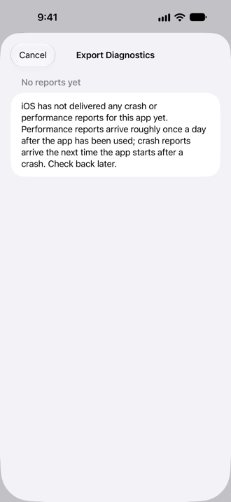{: width="200"}
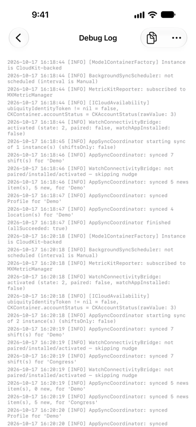{: width="200"}

**This iPhone** — **Debug Logging** (on by default in the beta), **View Debug Log** and **Export Diagnostics** for bug reports (see
the [FAQ](faq.md#something-is-wrong-how-do-i-report-it)). **Logs received from Apple Watch** — the logs the Watch sent, to view,
**Share All**, swipe to delete or **Delete All**; **Request Log from Apple Watch** asks the Watch to send its log, and **Log on
Apple Watch** switches the Watch's logging (it shows "Waiting for Apple Watch" until the Watch confirms). On the Watch:
**Settings → Diagnostics → Send Log to iPhone**. Nothing is sent unless you tap or request it.

### About

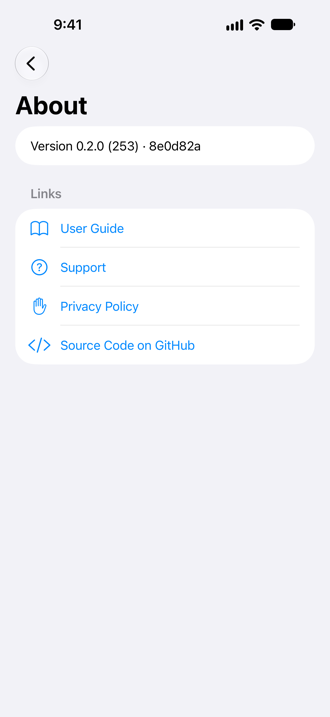{: width="200"}

Version and build, and links to the guide, support, privacy policy and the source code.

## Apple Watch

{: width="160"}

The Watch app shows only your **next shift** (name, time, location) and works on its own, without the iPhone nearby. Your
instances are shared between iPhone and Watch through iCloud.

To add the **complication**: on the Watch, touch and hold the watch face, tap **Edit**, choose a complication slot and pick
**Next Shift** (circular, rectangular and inline styles are available).

### Watch settings

{: width="160"}

Its **Settings** are a list of pages like the iPhone's.

- **Instances** — switch instances on or off (tap the switch; tapping the name opens the instance), add one directly on the Watch, Parallel Syncs.

  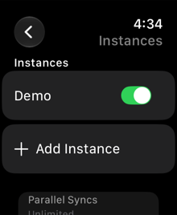{: width="140"}

- **Notifications** — the Watch's own reminder times.

  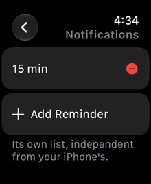{: width="140"}

- **Sync** — sync on app start; background sync by interval is not available on the Watch.

  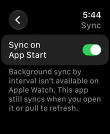{: width="140"}

- **Diagnostics** — its own debug logging switch and **Send Log to iPhone**.

  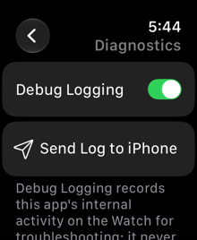{: width="140"}

- **About** — version and iCloud status.

  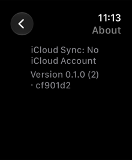{: width="140"}

## What your instance offers: the Features list

Not every Engelsystem server and not every account can use everything. The app finds out for each instance and keeps a **Features
list**: **Settings → Instances →** the instance → **Features**. Every row is one function (Shifts, News, News comments, Locations,
Location details, Messages, Work logs, Angel types, and the extra details of shifts) with one of three states:

- **Available** — the server offers it and your account may use it.
- **Not allowed for your account** — the server offers it but your account lacks a privilege; the row names the privilege when the
  server tells (for example `locations.view`). Ask the people who run your instance, or see [Server compatibility](#server-compatibility).
- **Not offered by the server** — the server does not have the function (yet).

Each row also says when it was checked. The list is learned from the server's answers during every sync and by **Test Connection**; it
belongs to this device and is not synced. While everything works the list is folded to one line ("11 of 11 features available"; tap it
to open it); as soon as something is missing it opens by itself, problems first. Areas that are not available are **hidden quietly**:
no error, no empty screens. Demo Mode offers everything, except the `demo://` address that only has News on purpose. See also the
[FAQ](faq.md#where-can-i-see-what-my-account-may-use).

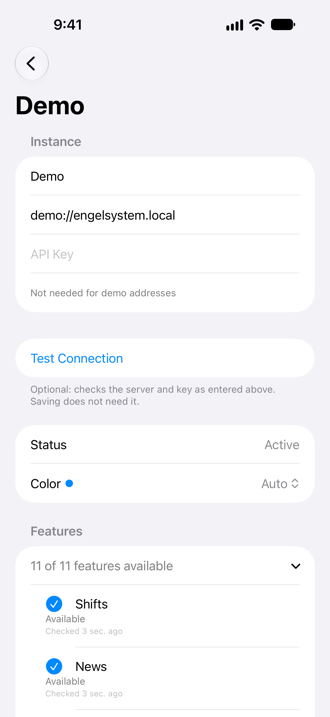{: width="200"}

## Server compatibility

The app uses Engelsystem's REST API **v0-beta** and works with the Engelsystem of today. Several improvements it can show are
still **open pull requests** at [engelsystem/engelsystem](https://github.com/engelsystem/engelsystem/pulls) (status
2026-10-15). Until they are merged **and** your instance runs a server version that includes them, the app keeps working and
simply hides what is missing:

| Pull request | Status | Without it |
|---|---|---|
| [#1709](https://github.com/engelsystem/engelsystem/pull/1709) — access concept: read with the `api` privilege or the matching web privilege | open | Every request needs an account in a group with the server's `api` privilege (for example “API” or “Bureaucrat”); otherwise no data loads and the **Features** list of the instance shows what is not allowed. With it, the account's own privileges are known and **Test Connection** shows a summary. |
| [#1710](https://github.com/engelsystem/engelsystem/pull/1710) — news comments | open | No comments and no comment counts in **News**. |
| [#1711](https://github.com/engelsystem/engelsystem/pull/1711) — single location and location details | open | **Locations** may be missing entirely (when only the API group may read them) and a single location cannot be refreshed. |
| [#1720](https://github.com/engelsystem/engelsystem/pull/1720) — private messages API | open | No **Messages** area at all: it only appears on servers that offer the messages API. With it, reading works with the `api` or the `user_messages` privilege, sending needs `user_messages`. |
| [#1721](https://github.com/engelsystem/engelsystem/pull/1721) — shift types readable with `user_shifts` | open, planned feature | Shift type descriptions (planned for the shift detail page) are only available to accounts with the `api` privilege. |
| [#1722](https://github.com/engelsystem/engelsystem/pull/1722) — shift lists and shift details | open | The shift detail page has no shift type description, tags, talk link, night shift hint or “sign out until” time from the server (it then says “usually until 3 hours before the start”). |
| [#1723](https://github.com/engelsystem/engelsystem/pull/1723) — shift entry details | open | The shift detail page has no “did not show up” flag and cannot tell whether you can still sign out (the button follows the usual 3 hours). |
| [#1724](https://github.com/engelsystem/engelsystem/pull/1724) — `GET /shifts/{id}` | open | A single shift cannot be refreshed on its own; the detail page shows the cached shift. |
| [#1725](https://github.com/engelsystem/engelsystem/pull/1725) — angel types readable like on the website | open, planned feature | No additional angel type details. |
| [#1726](https://github.com/engelsystem/engelsystem/pull/1726) — users and profile details | open, planned feature | No goodie score or vouchers in your profile. |
{: .table}

“Planned feature” means the app does not use these changes yet; the row says what they will make possible.

**Which privileges does my account need?** With the new access concept an account without the `api` privilege can read what
the website shows it: `news` for News, `locations.view` for Locations, `user_shifts` for shift types and shifts,
`angeltypes.view` for angel types and `user_messages` for Messages. The default group “Angel” has them. Until the
change is on your server, the account needs the `api` privilege (a group such as “API” or “Bureaucrat”).

Already merged and nothing to worry about: [#1708](https://github.com/engelsystem/engelsystem/pull/1708) (work logs for “my
own account”) and [#1712](https://github.com/engelsystem/engelsystem/pull/1712) (API tests).

## Good to know

- **Reminders** are scheduled from the last sync, so open the app (or pull to refresh) after a schedule change.
- The app only talks to the server you entered. There is no analytics and no advertising.
- **iPad** is supported with a sidebar layout.
- The app is open source (GPL-2.0): [github.com/cookieBerlin/EngelsystemClient](https://github.com/cookieBerlin/EngelsystemClient).
