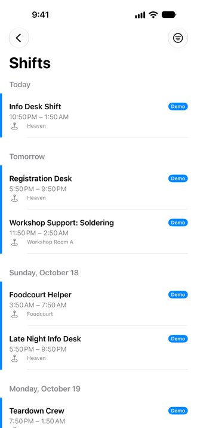
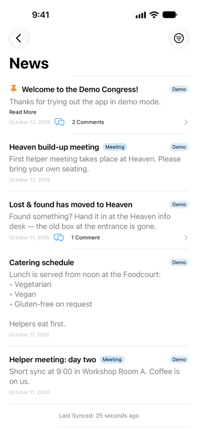
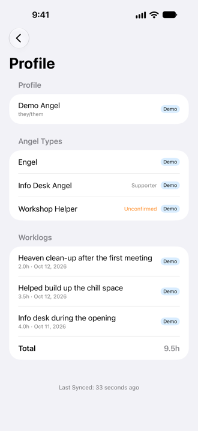
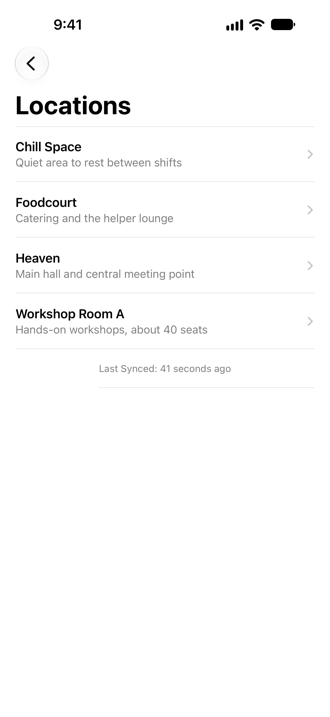
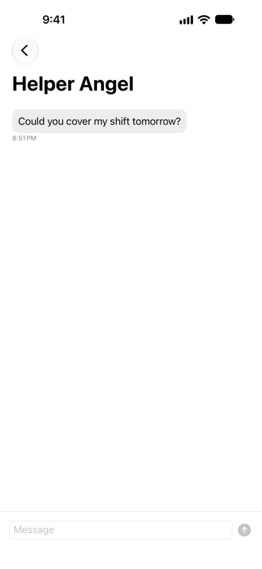
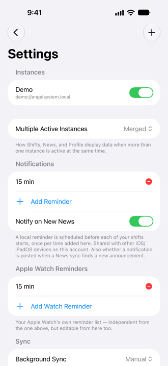
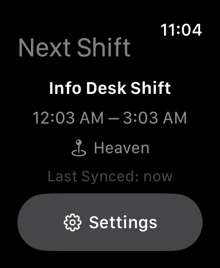
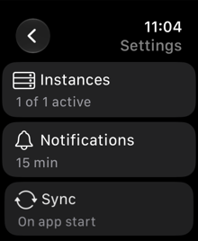

# User Guide

Engelsystem Client is an unofficial companion app for
[Engelsystem](https://github.com/engelsystem/engelsystem/), the volunteer-management system used by events like the
Chaos Communication Congress. It connects directly to your event's Engelsystem server with your own API key; there is no
account with the app's developer and no tracking (see the [Privacy Policy](privacy.md)). Questions? See the
[FAQ](faq.md) or [Support](support.md).

> **Beta:** the app is currently tested through Apple's TestFlight. [Join the beta](https://testflight.apple.com/join/Ksn65tz9) on your iPhone or iPad
> (you need Apple's free TestFlight app). Please report problems through TestFlight's "Send Beta Feedback" or on
> [Support](support.md).

## What the app does (and does not)

- Shows **your own shifts**, the **news**, your **profile** (angel types, work logs), the event's **locations**, and — on
  servers that support it — your **private messages**.
- Reminds you **before a shift starts** with local notifications.
- Works with **several events at once**, and has an **Apple Watch** app that shows your next shift.
- It is **read-only for shifts**: you cannot sign up for or change shifts in the app. That needs support in the Engelsystem
  server first.

## Try it without an account: Demo Mode

On the first screen tap **Try Demo Mode**. The app fills itself with sample data (shifts, news, a few messages) and makes no
network requests. You can leave Demo Mode on, or switch it off and add a real server later in **Settings**.

## Connect your Engelsystem server

1. In a browser, sign in on your event's Engelsystem website and open `/settings/api` (for example
   `https://engel.example.org/settings/api`). Press **Show API key** and copy the key. The app currently uses Engelsystem's
   REST API **v0-beta**.
2. In the app, on the first screen (or **Settings → Add Instance**), enter a **Name** (anything you like), the **Server**
   address (for example `https://engel.example.org`) and your **API key**.
3. Tap **Test Connection**. When it says the connection is verified, tap **Save**.

The API key is stored in the iOS Keychain (synced through iCloud Keychain if you use it) and is only ever sent to the server
you entered.

## The main screen

The main screen is a list of areas in three groups: **Communication** (News, Messages), **Event** (Shifts, Locations) and
**Account** (Profile). Messages and Locations only appear if your server offers them. When the app starts, or an area is no
longer available, you always land on this list. Pull down to refresh everything at once; the tiny progress banner at the top shows what is
syncing. The gear button opens **Settings**.

### Shifts

{: width="240"}

Your shifts, grouped by day ("Today", "Tomorrow", …). Each shift shows its time and location; tap the location to read its
description. Pull down to refresh. A small badge shows which instance a shift belongs to when you use several.

### News

{: width="240"}

Announcements from the event. Pinned posts come first. Tap **Read More** to expand long posts and the **comments** link to
read the discussion. The filter button at the top shows only **Meetings** or only other posts.

### Profile

{: width="240"}

Your name with your **DECT and mobile numbers** (tap to call, copy with the copy button), your **angel types** (with a note
if you are a supporter or still unconfirmed) and your **work logs** with the total hours. The work logs are the entries
added by hand; hours from your shifts are not part of that list.

### Locations

{: width="240"}

All rooms and places of the event with their descriptions. Tap one for details such as a DECT number and a link to the map. The map page is shown right inside the location screen (almost full screen, loaded fresh each time) with an **Open Map in Browser**
button. The map page's cookies (for example your consent) stay on your device; the app deletes them every 30 days by default (or keeps them only until you quit the app, if you choose that); in **Settings › Privacy** you can change that, delete them yourself or
switch to a plain link.

### Messages

{: width="240"}

Private messages with other helpers. Tap the compose button to start a conversation, tap a conversation to read and reply.
The **Messages** area only appears if at least one of your active servers supports it; if you do not see it, your server is
simply not offering it yet (it needs the open Engelsystem change
[#1720](https://github.com/engelsystem/engelsystem/pull/1720); see [Server compatibility](#server-compatibility)). You can delete your own messages; opening a conversation marks incoming messages as read.

## Settings

{: width="240"}

Settings is a short list of pages; each row shows a summary of its current state.

- **Instances**: all your events. Use the switch to turn an event on or off; tap one to edit its name, server or API key, or to
  remove it (this also removes the data cached for it). **Multiple Active Instances** chooses how Shifts, News and Profile show
  more than one active event: **Merged** (one list, labeled by event), **Switcher** (one event at a time via a control at the
  top) or **Sectioned** (one section per event).
- **Notifications**: the reminder times before each shift ("15 min", …). **Add Reminder** adds more, the red button removes
  one. **Notify on New News** posts a notification when a background sync finds new announcements. **Apple Watch Reminders**
  is the same for your Watch, independently of the iPhone list.
- **Sync**: **Background Sync** sets how often the app may refresh in the background (iOS decides the exact moment, so it can
  take longer than the interval); **Sync on App Start** refreshes when you open the app. The page also shows the iCloud status
  and the last background sync.
- **Phone Numbers**: which app opens internal and other numbers (see "Phone numbers" above).
- **Privacy**: **Map Links** (a plain link or the map inside the location screen), automatic deletion of the map page's data and
  **Delete Map Website Data**, plus a link to the privacy policy.
- **Diagnostics**: **Debug Logging**, **View Debug Log** and **Export Diagnostics** for bug reports — see the
  [FAQ](faq.md#something-is-wrong-how-do-i-report-it).
- **About**: version and build, and links to the guide, support, privacy policy and the source code.

## Apple Watch

{: width="160"}
{: width="160"}

The Watch app shows only your **next shift** (name, time, location) and works on its own, without the iPhone nearby. Its
**Settings** let you switch events on or off, add an instance directly on the Watch, and set the Watch's reminder times.
Your instances are shared between iPhone and Watch through iCloud.

To add the **complication**: on the Watch, touch and hold the watch face, tap **Edit**, choose a complication slot and pick
**Next Shift** (circular, rectangular and inline styles are available).

## Server compatibility

The app uses Engelsystem's REST API **v0-beta** and works with the Engelsystem of today. Several improvements it can show are
still **open pull requests** at [engelsystem/engelsystem](https://github.com/engelsystem/engelsystem/pulls) (status
2026-10-15). Until they are merged **and** your event runs a server version that includes them, the app keeps working and
simply hides what is missing:

| Pull request | Status | Without it |
|---|---|---|
| [#1709](https://github.com/engelsystem/engelsystem/pull/1709) — access concept: read with the `api` privilege or the matching web privilege | open | Every request needs an account in a group with the server's `api` privilege (for example “API” or “Bureaucrat”). Otherwise **Test Connection** warns that the account is not allowed to use the API (403) and no data loads. |
| [#1710](https://github.com/engelsystem/engelsystem/pull/1710) — news comments | open | No comments and no comment counts in **News**. |
| [#1711](https://github.com/engelsystem/engelsystem/pull/1711) — single location and location details | open | **Locations** may be missing entirely (when only the API group may read them) and a single location cannot be refreshed. |
| [#1720](https://github.com/engelsystem/engelsystem/pull/1720) — private messages API | open | No **Messages** area at all: it only appears on servers that offer the messages API. With it, reading works with the `api` or the `user_messages` privilege, sending needs `user_messages`. |
| [#1721](https://github.com/engelsystem/engelsystem/pull/1721) — shift types readable with `user_shifts` | open, planned feature | Shift type descriptions (planned for the shift detail page) are only available to accounts with the `api` privilege. |
| [#1722](https://github.com/engelsystem/engelsystem/pull/1722) — shift lists and shift details | open, planned feature | Planned shift detail page: no shift type description, tags, talk link, night shift hint or “sign out until” time from the server. |
| [#1723](https://github.com/engelsystem/engelsystem/pull/1723) — shift entry details | open, planned feature | Planned shift detail page: no “did not show up” flag and no information whether you can still sign out. |
| [#1724](https://github.com/engelsystem/engelsystem/pull/1724) — `GET /shifts/{id}` | open, planned feature | A single shift cannot be refreshed on its own. |
| [#1725](https://github.com/engelsystem/engelsystem/pull/1725) — angel types readable like on the website | open, planned feature | No additional angel type details. |
| [#1726](https://github.com/engelsystem/engelsystem/pull/1726) — users and profile details | open, planned feature | No goodie score or vouchers in your profile. |
{: .table}

“Planned feature” means the app does not use these changes yet; the row says what they will make possible.

**Which privileges does my account need?** With the new access concept an account without the `api` privilege can read what
the website shows it: `news` for News, `locations.view` for Locations, `user_shifts` for shift types and shifts,
`angeltypes.view` for angel types and `user_messages` for Messages. The default group “Angel” has them. Until the
change is on your server, the account needs the `api` privilege (a group such as “API” or “Bureaucrat”).

Already merged and nothing to worry about: [#1708](https://github.com/engelsystem/engelsystem/pull/1708) (work logs for “my
own account”) and [#1712](https://github.com/engelsystem/engelsystem/pull/1712) (API tests).

## Good to know

- **Reminders** are scheduled from the last sync, so open the app (or pull to refresh) after a schedule change.
- The app only talks to the server you entered. There is no analytics and no advertising.
- **iPad** is supported with a sidebar layout.
- The app is open source (GPL-2.0): [github.com/cookieBerlin/EngelsystemClient](https://github.com/cookieBerlin/EngelsystemClient).
